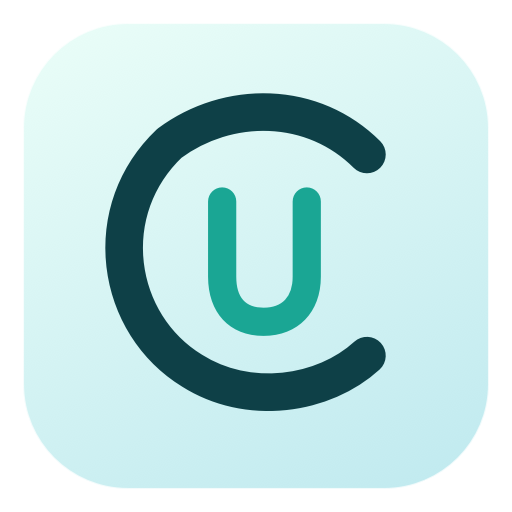
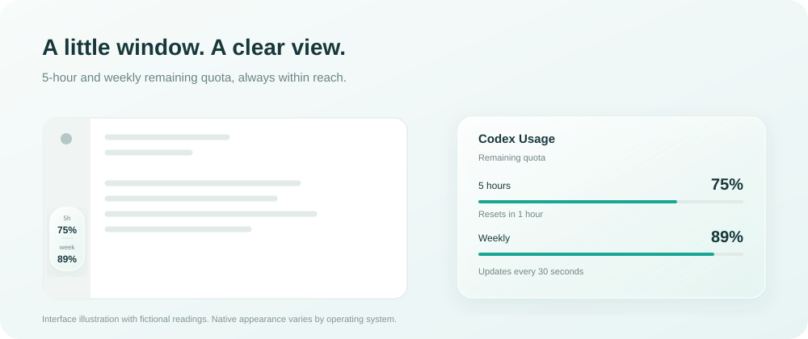

<p align="center"></p>
<h1 align="center">Codex Usage</h1>
<p align="center">Your 5-hour and weekly remaining quota, always within reach.</p>
<p align="center"><a href="README.md">简体中文</a> · English</p>



An independent macOS and Windows desktop companion that reads Codex usage through your local Codex CLI. It is not an official OpenAI plugin and does not modify or inject code into the desktop app.

## Download

Get both platforms from the same **[GitHub Release](https://github.com/ihatetheworld-ckl/codex-usage/releases/latest)**.

| Archive | Platform | Installation |
| --- | --- | --- |
| `CodexUsage-macOS-universal.zip` | macOS 13+, Apple Silicon and Intel | Extract and move `Codex Usage.app` to Applications |
| `CodexUsage-Windows-x64.zip` | Windows x64; Windows 11 recommended | Extract the entire folder and run `CodexUsage.exe` |
| `SHA256SUMS.txt` | Both | Verify downloaded archive hashes |

The Windows portable archive includes the .NET runtime. Both versions require a locally installed, signed-in **[Codex CLI](https://learn.chatgpt.com/docs/cli)**. The packages are not Apple-notarized or Authenticode-signed, so your operating system may display a developer-verification prompt.

## Getting started

```sh
npm install -g @openai/codex
codex login
```

Launch Codex Usage, then bring the Codex / ChatGPT desktop window forward. The capsule appears in its lower-left rail. On Windows, install and sign in from native PowerShell: WSL uses a separate environment and does not automatically share its login state. A working desktop-app login does not guarantee that the CLI is signed in.

Use `CODEX_USAGE_CLI` for a nonstandard CLI location. Windows supports native `codex.exe` and conventional npm `codex.cmd` installations, invoking Node.js directly instead of interpolating a shell command.

## Features

- 48 × 84 point capsule displaying **remaining** 5-hour and weekly quotas; polls every 30 seconds.
- Click or right-click for remaining progress, reset countdowns, refresh and settings.
- **Docked:** follows the desktop window and snaps back to the lower-left corner when a drag is released.
- **Free-floating:** keeps its dropped position, including across mode changes and restarts.
- Menu-bar-only / tray-only mode, stale-data indication, and unknown values shown as `—`.
- macOS 26+ uses native clear Liquid Glass; older macOS uses a frosted material. Windows uses its own translucent rounded card, not macOS Liquid Glass.
- No administrator, Accessibility or Screen Recording permission is required.

Quit before replacing the app or the entire portable folder to update. Startup registration and automatic updates are not enabled by the application.

## Privacy

Reads `account/rateLimits/read` through the official [Codex App Server](https://learn.chatgpt.com/docs/app-server). The CLI manages its own authentication; this app does not read, copy or log tokens. It does not run model inference, create chats, capture your screen, inspect conversation text, or upload source code. It opens no network listener and requires no OpenAI API key.

Only display preferences are saved. The Codex CLI still contacts OpenAI, manages its login and writes its usual local logs. Service-side readings can lag; a 30-second poll is not token-by-token accounting.

## Build

macOS requires Xcode 26+ and Python 3:

```sh
bash scripts/build.sh
bash scripts/package-macos.sh
bash scripts/test.sh
bash scripts/test-ui.sh
```

Windows requires the .NET 10 SDK:

```powershell
dotnet run --project windows/CodexUsage.Tests -c Release
./scripts/package-windows.ps1
```

Archives are written to `dist/`. The WPF project can also be cross-compiled on macOS with `dotnet build windows/CodexUsage.Windows -p:EnableWindowsTargeting=true`, but execution requires Windows.

## Validation and limitations

See [TESTING.md](docs/TESTING.md). Both platform jobs must succeed before a tag release publishes both downloads.

macOS has been checked with a real account and native window interactions on Apple Silicon. The Intel slice is cross-compiled. Windows CI checks actual WPF startup, docking, its drag controller, details and transparent corners with synthetic quotas and a native test host. **A real-account check on the user's Windows device has not been completed.**

The default dock assumes the desktop app's 56-point left rail. App redesigns, hidden rails, unusual installation locations and mixed-DPI multi-monitor setups may require adaptation. The tool cannot distinguish Codex from other pages inside a shared ChatGPT desktop window. It does not select remote accounts or provide its own login flow.

Preferences: macOS `local.codex-usage-sidebar`; Windows `%LOCALAPPDATA%\CodexUsage\settings.json`. Quit and delete the application to uninstall, optionally removing these preferences.

## License

Source and the original CU logo: **[Apache-2.0](LICENSE)**. See [NOTICE](NOTICE) and [THIRD-PARTY-NOTICES.md](THIRD-PARTY-NOTICES.md) for runtime and trademark notices.
